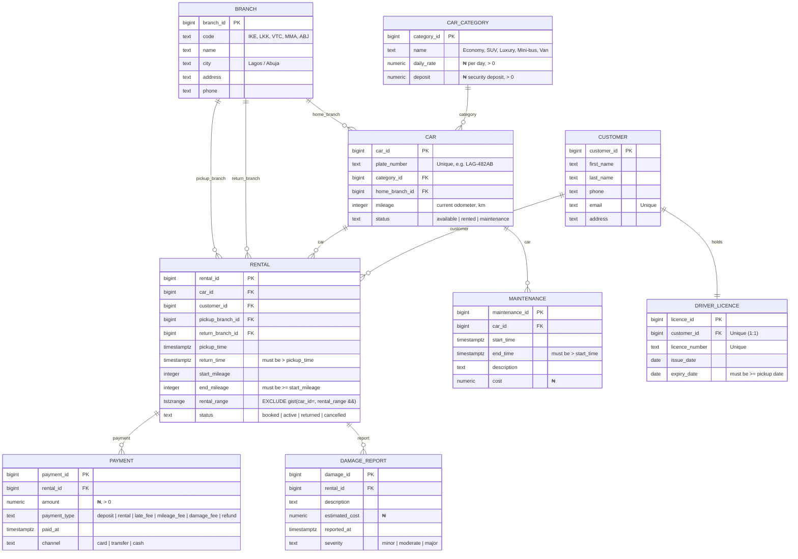

# Portfolio 1 — ER Diagram (Mermaid)

> DriveEasy Rentals — entity-relationship diagram for 9 tables.
> Render this file in any Mermaid viewer (GitHub renders it natively in `.md`).

## Constraints encoded in the ER / schema

1. **EXCLUSION (no overlapping rentals per car)** — on `rental.rental_range` (a `tstzrange`) using `btree_gist`: `(car_id WITH =, rental_range WITH &&)`.
2. **Trigger: a car in maintenance can't be rented in that period** — `trg_no_rental_during_maintenance` blocks `INSERT` on `rental` whose range overlaps an existing `maintenance` row for the same car.
3. **Trigger: driver's licence valid on pickup date** — `trg_licence_valid_on_pickup` raises if `driver_licence.expiry_date < rental.pickup_time::date`.
4. **CHECK: `return_time > pickup_time`** and **`end_mileage >= start_mileage`**.
5. **CHECK: `daily_rate > 0`, `deposit > 0`, `payment.amount > 0`**.
6. **UNIQUE:** `car.plate_number`, `customer.email`, `driver_licence.licence_number`, `driver_licence.customer_id` (1:1).
7. **FK** integrity on all `*_id` columns; `ON DELETE RESTRICT` on cars/customers (cannot delete while rentals exist).
